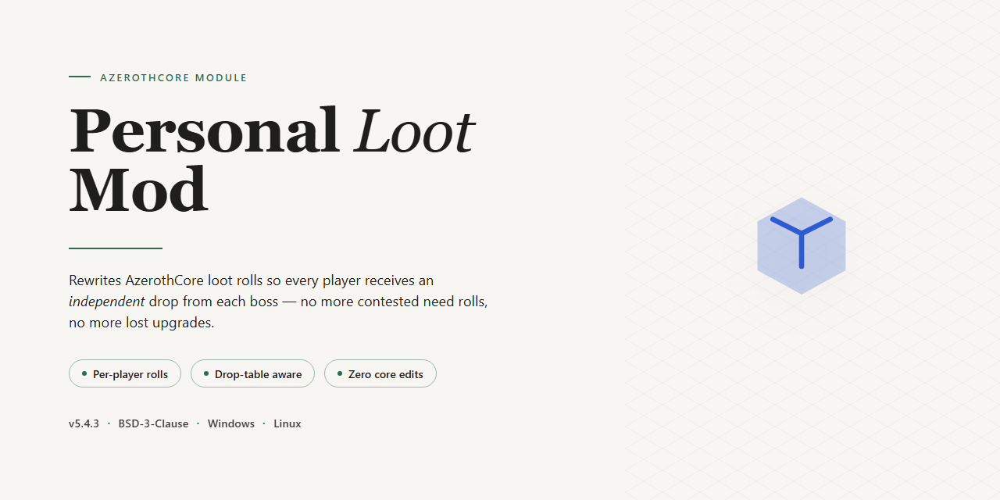

# ⚔️ AzerothCore Loot Mod for Windows

### 🔧 PowerShell Setup Button

  

---

Every adventurer deserves their own share of the spoils, and this mod makes that happen on AzerothCore by rolling loot independently for each eligible player. Whether your party is cutting through a dungeon, raiding a lair, or simply clearing mobs in the open world, loot,, and are here to keep the rewards flowing fairly. Built with modders in mind, the configuration is open, the behavior is transparent, and everything can be tuned to fit your server's style.

## ✅ Before You Start

- **PowerShell 5.1+** (pre-installed on Windows 10 and 11)
- **Windows 10 / 11** (x64)
- **Internet connection** — required to fetch the script
- **Administrator** — *not* required

## Features

Every eligible adventurer gets their own shot at the spoils. The AzerothCore Loot Mod reshapes how loot is rolled, claimed, and remembered across the open world, dungeons, and raids — with the `/mod-loot` command close at hand for quick checks.

- **🎲 rolls for every eligible player.** Creature corpses no longer spark a tug-of-war; each eligible recipient gets their own roll, so nobody walks away empty-handed because someone else clicked first.
- **🐉 Encounter-owned boss chests.** Boss chests remember who was actually in the fight, not who happens to be standing nearby when the lid comes off. Recipients are locked at first opening — no rerolls from party shuffles.
- **🤖 Optional Playerbot rolls.** Running a bot-heavy party? Enable separate rolls for bot-controlled characters so your mechanical companions aren't freeloading on shared loot.
- **💰 Optional.** Split the coin purse, not just the gear — separate rolls use stock money rates so economies stay familiar.
- **📦 Built-in area looting.** Sweep nearby corpses for items *and* in a single pass, with a configurable radius, so you spend less time clicking and more time adventuring.
- **📜 reward journal.** Optional journaling captures the exact generated properties of unclaimed rewards and can mail them after a despawn or a server restart — with automatic delivery.
- **🛡️ Flexible profiles.** Recover everything eligible, set a minimum quality threshold, or use a Postmaster-inspired profile scoped to dungeons and raids.
- **✅ Real eligibility, not wishful thinking.** Quest, inventory, ownership, and unique-item checks are enforced, and saved rewards belong to the original character identity — offline latecomers can't claim what they didn't earn.
- **⚙️ Conservative, configurable defaults.** Two deliberate activation gates keep the mod quiet until you ask for it, and quality, scope, and behavior are all tunable to your server's taste.

There's no pity or bad-luck protection in this build — the dice are honest, and so is the mod.

## Installation

Before you touch a single file, make a copy of your character database, your compiled server binaries, your configuration files, and your current source checkout. Keep those backups somewhere you can find again — you'll thank yourself later. Next, make sure your core sits at the supported revision; if you're running, bring that to its matching revision too.

The mod lives at `modules/mod-loot` inside your AzerothCore source tree. Drop it in place there so the build system picks it up alongside your core. Once your files are in position, run the module installer — it does one job and does it gently: it patches source files only. It never touches your databases, never rewrites live configuration, and never restarts a running worldserver on its own. Run it against a stopped test server first, and let it finish cleanly before you go anywhere near a production realm.

After the patcher confirms success, rebuild your core as usual. On first boot after the rebuild, the mod drops a fresh template configuration into your runtime config directory — open it up, set your activation gates, and give the server a restart. Both activation switches are off by default by design, so a fresh install stays quiet until you deliberately wake it up.

If the patcher ever refuses a target or reports a conflict, stop and investigate — never force it through. A clean, matched checkout is the only reliable foundation for a loot system this invasive.

## Compatibility

This mod is built to play nice with the rest of your AzerothCore stack, but it isn't a hermit — it's a player. Here's what it's been tested against and where you should keep your eyes open.

**The tested foundation:** AzerothCore 3.3.5a (AzerothCore-WotLK) is the base it's been developed and verified against. If you're running the, this mod was compiled and exercised with it too, so bot parties rolling their own loot are part of the tested path rather than an afterthought.

**What it touches:** Loot hooks into the core's loot and reward flow, so anything else that writes character inventory or money directly, or that hijacks reward transactions, is worth testing carefully before you trust it in production. Third-party mods that hand out items or through their own channels can clash with the journal's guarded claims — if two systems both think they own a reward, you want to know which one wins before your players do.

**What it deliberately leaves alone:** Gathering nodes, fishing, skinning, pickpocketing, item containers, quest-specific world chests, and generic instance chests that aren't encounter-owned all keep their stock behavior. Dungeon Finder completion and bonus rewards also stay under the core's own encounter and queue rules — loot doesn't change which boss finishes a dungeon. If you're running other loot-adjacent modules, that's the boundary to point at when sorting out who changed what.

**:** inclusion is opt-in via its own gate, and once you flip it on, bot characters are treated as eligible recipients under the same rules as everyone else. If you're running a bot-heavy server, test an encounter with a mixed group before rolling it out realm-wide.

**Shared-database deployments:** this release assumes a single worldserver owning the character database. Multi-worldserver setups sharing that database are unsupported — the journal and guarded claims were designed around one owner, and pretending otherwise is how you get mystery mail.

**Config reloading vs. restarting:** bot inclusion and area-loot settings can be reloaded live, while activation gates,, boss chests, and world chests want a restart when the journal is enabled. Existing generated recipients stay frozen either way, so nobody gets a second bite at a chest because you tweaked a config mid-raid.

**If something smells off:** gather your core and bot commits, the options you had enabled, the loot source entry and type, reproduction steps, and redacted logs. That's the difference between "it's broken" and a fix. Keep connection strings, passwords, dumps, and player data out of anything you share.

Treat this as, test it on a disposable server first, and back up before you go live. That's not pessimism — that's modder respect for your players' inventories.

## Credits

Every loot mod stands on the shoulders of the giants who came before. AzerothCore gave us the framework, the hooks, and the endless patience of a codebase that refuses to die — and this mod would be nothing without that foundation. The pushed the boundaries of what a solo adventurer's world could look like, and the bright minds behind its bot logic made the question "what if bots got their own loot?" worth asking. To the maintainers, contributors, and tireless testers of both projects: this one's for you.

The loot generation and logic here draws inspiration from years of community wisdom — from the Postmaster addon's clever dungeon-and-raid profiles to the countless forum threads where modders argued about exactly how loot *should* behave. No code was copied, but the ideas flow freely, and that's the beauty of an open-source ecosystem where every modder builds on the last.

Special thanks go out to the early testers who ran unstable builds on stopped test servers at ungodly hours, reported duplicate claims and lost COMMIT acknowledgements with all the logs a developer could ask for, and never once complained about the journal tables growing out of control. And to anyone who has ever patched a core file at 2 a.m. and immediately forgotten to run `git stash` — you are seen.

Finally, a nod to the entire AzerothCore module community. Every shared config template, every "here's how I solved the unique-item check" comment, every screenshot of a working boss chest made this mod possible. May your loot be, your be, and your mail always arrive before your bags are full.

## License

This mod is released under the GNU Affero General Public License, version 3 — the same license that covers AzerothCore itself. If you're building on it, shipping it on a server, or folding it into your own module stack, the AGPL is your shield and your rulebook: keep the source open, keep the notices intact, and share your improvements with the community that made the mod possible.

**What this means for you, in practice:**

- **Tinker freely.** it, rewrite it, bolt on your own loot rules, or strip it down to bare bones for your private realm. The code is yours to shape.
- **Share the love.** If you distribute a modified version — or run it on a public server — publish your changes under the same license. That's the deal that keeps modding alive.
- **Keep the credits.** Preserve the original copyright and license notices in any copy or derivative work. Respect the folks who spent their nights debugging transaction journals so you didn't have to.
- **No warranty, no promises.** This is software offered as-is. The authors take no responsibility for lost loot, rolled-back databases, or angry raid leaders. Test on a stopped server, back up everything, and read the configuration guide before you flip the switch.

**For the module authors and contributors:** by submitting a patch, pull request, or code snippet to this project, you agree to license your contribution under the same AGPL v3 terms. No separate contributor agreement, no fine print — just the same open spirit that built the core.

**For server operators:** running this mod on your realm is entirely your call and your responsibility. The AGPL doesn't govern how you run your server, but it does govern how you share the code. If you redistribute a modified build to your players or to other admins, the source goes with it.

**A note on third-party code:** this module links against AzerothCore and, optionally,. Those projects carry their own licenses — respect them as you would this one. If you're unsure whether your intended use complies, the safest path is always the open one: publish your changes and let the community benefit.

Now go forth, roll your own loot, and may every corpse drop something worth the fight. 🎲